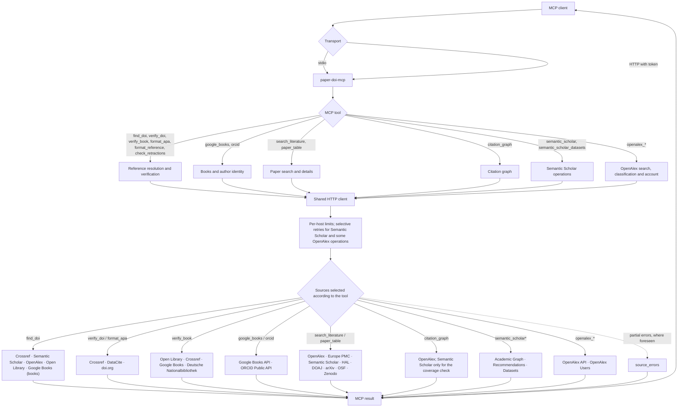

# paper-doi-mcp

[](https://pypi.org/project/paper-doi-mcp/)
[](LICENSE)

An MCP server for verifying academic citations and searching the literature. It resolves and checks DOIs, verifies book editions, searches several open databases and builds citation graphs to visualise. The guiding principle is precision: when a match is not certain, the tool says so instead of proposing a plausible DOI.

## Installation

The package is on PyPI as [`paper-doi-mcp`](https://pypi.org/project/paper-doi-mcp/) and needs Python 3.10 or later. The simplest way to run it is [uv](https://docs.astral.sh/uv/): `uvx paper-doi-mcp` downloads it into an isolated environment and starts the stdio server. No key is required; `CONTACT_EMAIL` is recommended, since Crossref and OpenAlex give faster service to requests that carry one. The optional keys are listed under [Environment variables](#environment-variables).

### Claude Desktop

In `claude_desktop_config.json` (macOS: `~/Library/Application Support/Claude/`, Windows: `%APPDATA%\Claude\`):

```json
{
  "mcpServers": {
    "paper-doi": {
      "command": "uvx",
      "args": ["paper-doi-mcp"],
      "env": { "CONTACT_EMAIL": "you@example.org" }
    }
  }
}
```

If Claude Desktop does not find `uvx`, use its absolute path (`which uvx`).

### Claude Code

```sh
claude mcp add paper-doi --env CONTACT_EMAIL=you@example.org -- uvx paper-doi-mcp
```

### pip

```sh
pip install paper-doi-mcp            # or: pip install "paper-doi-mcp[semantic]" for local embeddings
paper-doi-mcp                        # stdio; MCP_TRANSPORT=http for Streamable HTTP
```

The package installs four commands: `paper-doi-mcp` (the server), `paper-doi-weekly` (the weekly job), `paper-doi-semantic` (`download | embed | status` for the embedding model) and `paper-doi-philarchive` (`harvest`). Maps, the corpus index and the search log are kept in `STATE_DIRECTORY`; when it is not set, the server uses `/var/lib/doi-mcp` if that folder exists and `~/.local/state/paper-doi-mcp` otherwise.

The tools that read your Zotero library and Obsidian notes (`search_everything`, `check_draft`, `coverage_report`, the library columns of the maps) need the snapshots written by the companion servers [zotero-mcp](https://github.com/graph-ist/zotero-mcp) and [obsidian-mcp](https://github.com/graph-ist/obsidian-mcp) in a shared `KNOWLEDGE_DIR`. Without them those tools say so and everything else works.

## Architecture

The client sends an MCP request; the server routes it to the matching tool. The bibliographic tools query the relevant sources, while the dedicated ones forward operations to the OpenAlex or Semantic Scholar APIs. HTTP requests share transport, limits and error handling.



## Tools

The server has two layers. The verification and search tools (from `find_doi` to `paper_table`) cross-check the sources and return explicit states. The gateway layer (`openalex_*`, `semantic_scholar*`, `google_books`, `orcid`) forwards calls to the APIs and returns the native JSON: it is registered only with `ENABLE_GATEWAY=true`, because it adds eleven definitions to the context of every session. All tools answer with a dictionary with `status`; an invalid argument gives `status: invalid_input` with a `detail` that names the parameter and the allowed values.

| Tool | What it does | Sources |
|---|---|---|
| `find_doi` | Finds the DOI of an article or book from title, first author and year. Returns `match` only if title, author and year agree; otherwise `no_confident_match`. For books (`is_book=true`) the year must match the cited edition; the edition and ISBN data from Open Library and Google Books are returned as alternative identifiers (`book_info`, `book_info_google_books`). | Crossref, Semantic Scholar, OpenAlex, Open Library, Google Books (books) |
| `verify_doi` | Checks that a DOI exists and belongs to the expected work (title, author, year, volume, issue, pages). Routes by registration agency: Crossref, or DataCite (Zenodo, arXiv, OSF, datasets); for other registries it returns `registered_unsupported_agency` instead of "not found". Flags retractions, corrections and expressions of concern (Crossref only). With `expected_orcid` it compares the ORCID iD with those deposited for the authors (`author_orcids`): `match`; `mismatch` only if all authors have an iD and none is the expected one; otherwise `not_in_source`, because the deposit is optional. For unsupported agencies the iD appears in `unchecked`. | Crossref (with Retraction Watch data), DataCite, doi.org |
| `verify_book` | Verifies an edition (year, publisher, ISBN) by comparing four catalogues. `verified` if at least two agree. The `agreement` field counts the groups of independent catalogues (Open Library and Google Books share publishers' feeds and count as one) and reports the level (`high` with at least two groups and no conflict, `medium` with one conflict, `low` with a single group, `none`). In `conflicts` it flags a year or publisher on which two confirming sources have nothing in common (different editions, or imprint and publishing group), without excluding the result. | Open Library, Crossref, Google Books, Deutsche Nationalbibliothek |
| `google_books` | Search (`search`, with the native keywords `intitle:`, `inauthor:`, `isbn:`...) and reading of a volume (`volume`): title, authors, publisher, date, ISBN. Native parameters forwarded in `params`; returns the original JSON. | Google Books API |
| `internet_archive` | Digitised books and texts on the Internet Archive (also Open Library scans): by title, author, year, ISBN or Lucene query. For each record the access: `public` (free reading and PDF), `borrowable` (lending with an archive.org account), `print_disabled_only`. | Internet Archive |
| `orcid` | Search in the registry (`search`, Solr syntax, with ORCID iD, names and institutions) and reading of the public data of a record (`person`, `works`). The iD is validated with the checksum before the request. Works without credentials; with `ORCID_CLIENT_ID` and `ORCID_CLIENT_SECRET` it uses a `/read-public` token. A name match is a candidate, not an identity. | ORCID Public API |
| `format_apa` | Returns the APA reference of a DOI through content negotiation, with the record's structured fields. Flags with `title_case_suspected` the titles that look like title case (APA wants sentence case) without converting them. `unsupported` if the registration agency does not offer it. | doi.org |
| `format_reference` | Reference of a DOI in BibTeX, RIS, CSL-JSON or in any CSL style (`chicago-author-date`, `modern-language-association`, `ieee`…), through content negotiation. Same warning as `format_apa`: the metadata is not verified. | doi.org |
| `check_retractions` | Retractions, expressions of concern and corrections for a list of DOIs (up to 1000, e.g. a whole Zotero library) or, with `map`, for all the works with a DOI in a map, which are marked; from Crossref with Retraction Watch data. DataCite DOIs end up in `not_checked`. At most 2 parallel requests to Crossref, with retries on 429s. | Crossref |
| `check_citations` | Cross-check, without network, between the author-date citations in the text and the APA bibliography: citations without an entry, uncited entries, discordant years, ambiguous entries (same author and year without a suffix). It matches only the first author's surname and the year: the entries must then be verified with `find_doi` and `verify_doi`. | Local computation |
| `search_literature` | Search with boolean syntax on one or more databases, with abstracts and keywords, deduplication and a reproducible log of the queries. `philarchive` queries the local copy of PhilArchive harvested via OAI-PMH by the weekly job (`paper-doi-philarchive harvest`). | OpenAlex, Europe PMC, Semantic Scholar, HAL, DOAJ, arXiv, OSF Preprints, Zenodo, DNB, PhilArchive (local copy) |
| `citation_graph` | Citation graph around one or more works: references, most-cited citing works, citation edges, co-cited pairs and bibliographic coupling (shared references). For each node it says how many seeds it is linked to. Designed for D3 visualisations (year/citations timeline, similarity network). With `check_coverage` (default) it compares for each seed with a DOI the counts of references and citations between OpenAlex and Semantic Scholar (`coverage_check`), to tell a real absence from a coverage gap. | OpenAlex, Semantic Scholar (check only) |
| `map_create`, `map_add_seeds` | Creates a persistent literature map (SQLite in `STATE_DIRECTORY`) and adds the seeds (DOI or OpenAlex id); a candidate already in the map becomes a seed. If no seed can be added, `map_create` answers `status: "partial"` (map created) with `detail` and the errors in `warnings`; with seeds only partly successful it stays `ok` but with `warnings`. | OpenAlex |
| `map_expand` | Grows the map from the seeds: `references`, `citing`, `similar` (Semantic Scholar recommendations), `authors` (most-cited works of the first three authors). New works enter as candidates with state `new`: at most `max_new` per call (150), the most linked first; you can expand from any work in the map; duplicates are merged; at most 2000 works per map. | OpenAlex, Semantic Scholar |
| `map_suggest` | Candidates most likely missing, sorted by `seeds_linked`, `seed_cocited`, `seed_coupling`, citations; excludes read and dismissed ones. Says why (`found_by`). | Local computation |
| `map_mark` | Reading state: `to_read`, `read`, `dismissed`, `new`, with an optional note. The state lives in the map, not in the notes. | Local computation |
| `map_get`, `map_list` | Content of a map (works and recomputed links: citations, co-citation, coupling) and list of the maps with counts. Each work carries `cited_in_map`, `cited_in_map_nonseed` and `cited_by_seed_citers` (how many works in the map cite it, how many among the candidates, how many of these also cite another seed); co-citation and coupling are limited to `max_pairs` pairs (500, maximum 5000) and `cocitation_truncated` / `coupling_truncated` say whether some are left out. `added` and `refs_source` remain in the works as information. For large maps `compact=true` removes from the works `notes`, `verified`, `zotero_tags`, `found_by`, `note`, `added` and `refs_source`, and `fields=[…]` keeps only the listed fields plus `id` (it takes precedence over `compact`; unknown names are ignored and reported in `warnings`); without the two parameters the response does not change. The computation runs in a thread, without stopping the other tools; the computed view (links and scores) stays in a small in-memory cache (at most 8 entries per process, shared with `map_suggest`) and every write to the database invalidates it, so it never serves old data. | Local computation |
| `map_job_status` | Status of a background job (see *Long operations*): `running`, `ok`, `error`, `interrupted`, `not_found`, with `progress` (`done`, `total`, `step`) and, when the job has finished, `result` = the response the tool would have given. | Local computation |
| `map_rename`, `map_remove`, `map_delete` | Renames a map or changes its description; removes single works; deletes a whole map (the exact name must be repeated in `confirm_name`). | Local computation |
| `map_prune`, `map_refresh` | Reduces a map (seeds, works with a state and the first N most-linked candidates); re-downloads from OpenAlex citations, momentum, topic and retractions of all the works; with `new_citing` it first adds the new works that cite the seeds since the last check (an on-demand check, not an alert). Both merge duplicates (same title and first author, close years); `duplicates_merged` is a number here, a list of groups in `map_expand` and `map_add_seeds`. If a seed errors or returns a full page (`per_seed`), the check date does not advance and the response has `truncated` and `watch_not_advanced`. OpenCitations counts are requested three at a time, with retries on 429s. | OpenAlex, OpenCitations |
| `map_export` | The map as a Markdown reading list (seeds, then works by state, with DOI, Zotero and note links), to save in Obsidian outside the schema, e.g. `Maps/<name>.md`. | Local computation |
| `map_add_patents` | Adds patents to a map as `P:<number>` nodes, each with the literature that the search report cites with a printed DOI (resolved in OpenAlex, enters as a `patent:P:…` candidate); citations without a DOI come back in `unresolved` to be resolved with `find_doi` and `verify_doi`. Patents appear in `patent_edges` of `map_get`, never in co-citation, coupling or merging of duplicates: the examiner's citation establishes prior art, not an intellectual debt. If no patent can be added it answers `status: "error"` with `detail`; an EPO 403 (fair use) is retried once after a pause. Registered only with EPO credentials. | EPO OPS 3.2, OpenAlex |
| `search_everything` | Search in the user's corpus, not on the web: Obsidian notes by section, texts of the PDFs and EPUBs in Zotero by page, highlights and comments. Local FTS5 index (`corpus.sqlite` in `STATE_DIRECTORY`) built from the files that the other two servers write in `KNOWLEDGE_DIR` (`notes_text.json`, `fulltext/KEY.json`) and updated at every call by mtime. Lexical, in the language of the query; `zotero_key` restricts to one item. With `semantic=true` it searches by meaning with local multilingual embeddings (see below): a query in Italian finds a passage in German; `score` is the cosine similarity. | Local computation |
| `map_intents` | Why the works in a map cite each other, from Semantic Scholar: intents (`background`, `methodology`, `result`), influential citation and sentences around the citation, for the seeds or for the indicated works; edges whose sentences carry markers of contrast or criticism are marked `contrasting`, candidates for the Objections of a thesis note, to be read in the text. Saved with the map (every 5 works); `map_get` returns them in `edge_intents` (`citing->cited`). When the merging of duplicates deletes a record, the intents of its edges pass to the kept id (if a record for the same edge already exists the more complete one stays, with `influential` and `contrasting` in OR). `works_skipped` lists the works chosen and left out (without a DOI or beyond `max_works`), `truncated` says whether a request hit the limit of 1000 citations. | Semantic Scholar |
| `check_draft` | The `[@citekey, p. N]` citations of a manuscript against the library: key resolved by Better BibTeX citekey (`Citation Key:` in Extra), item key or surname+year if unique; unresolved or ambiguous keys, items without a `Verified: … match` line, literal quotations without a page, with `retractions=True` the retracted DOIs; `bibliography_keys` for `export_items`. | Crossref (retractions only) |
| `coverage_report` | What a project lacks (tag `cited/<project>` or collection): items without a note, without a PDF, not verified; notes without an item in `reference`; notes that point to vanished items. | Local computation |
| `search_log` | The log of searches and maps (`STATE_DIRECTORY/searches.jsonl`, written by every `search_literature` and `map_create`): with `query` it says whether and when the same search, or a similar one, has already been done and with how many results; without it, the latest entries. The weekly report lists the week's searches. | Local computation |
| `weekly_report` | The latest weekly report (new citing works per map, retractions in the library, coverage by project, maintenance); `run_now=True` runs it immediately. | OpenAlex, Crossref |
| `patent_search`, `patent_get` | Patents from EPO Open Patent Services (about 140 million documents): free-text search on title and abstract or in native CQL; for a patent bibliographic data, cited patents, citing patents and the scientific literature cited in the search report. A DOI appears only if printed in the citation; for the first `resolve_literature` citations without a DOI (20 by default) a Crossref search with the rules of `find_doi` may propose a `doi_candidate` with a score, to be confirmed with `verify_doi`. Registered only if `EPO_OPS_KEY` and `EPO_OPS_SECRET` are set. | EPO OPS 3.2, Crossref |
| `paper_table` | Detail rows for a list of DOIs, OpenAlex ids or arXiv ids (up to 300): abstract, keywords, topic, TL;DR, venue, open access, retraction. | OpenAlex (in blocks of 50), arXiv as a fallback, Semantic Scholar (one batch request) |
| `semantic_scholar` | Academic Graph and Recommendations in one tool with 16 actions: papers (details, authors, citations, references, batch, relevance search, boolean bulk, match, autocomplete), authors (details, publications, search, batch), text snippets, recommendations from a paper (`recommend_single`) or from lists of positive and negative examples (`recommend_multi`). The actions that return lists have `limit` 20 by default. | Semantic Scholar Academic Graph and Recommendations |
| `semantic_scholar_datasets` | Releases and signed links of the datasets (`releases`, `release`, `files`, `diffs`). Does not download the files. | Semantic Scholar Datasets |
| `openalex_entity` | Lists and details of all 26 resources of the catalogue, with filters, search, aggregations, fields and free cursors; with `autocomplete` the suggestions and quick resolution of identifiers by entity type. Lists have `per_page` 25 by default. | OpenAlex |
| `openalex_text` | Classifies title and abstract by topic and keyword, via GET or POST. | OpenAlex |
| `openalex_query` | Runs an OQL query (string) or OQO (object); consumes the budget. | OpenAlex |
| `openalex_query_inspect` | Translates (also from a classic URL), validates, consults the grammatical context, properties and specifications of the language without executing. | OpenAlex |
| `openalex_status` | Consults the quota and the metadata/links of the changefiles; the latter require an enabled plan. | OpenAlex |
| `openalex_account_read` | Reads collections, members, imports and saved searches, without modifying them. | OpenAlex |
| `openalex_account_write` | Creates, updates or deletes collections and saved searches, manages members/imports and submits corrections. Preview by default; requires explicit confirmation to send. | OpenAlex, OpenAlex Users |

### OpenAlex coverage

The six dedicated tools, active only with `ENABLE_GATEWAY=true`, cover the current resources and user operations of the [endpoint catalogue](https://help.openalex.org/api/endpoints/), integrated with the pages on [OQL/OQO queries](https://help.openalex.org/api/oql/), [collections](https://help.openalex.org/api/collections/), [saved searches](https://help.openalex.org/api/alerts/) and [corrections](https://help.openalex.org/api/author-curation/). The administrative routes, the old deprecated account routes and the operations for creating/rotating credentials are not exposed.

`openalex_entity` exposes `GET /{entity}` and `GET /{entity}/{entity_id}` for these resources:

| Group | Values of `entity` |
|---|---|
| Main entities | `works`, `authors`, `sources`, `institutions`, `publishers`, `funders`, `awards` |
| Components | `locations`, `raw-affiliation-strings` (list only, no single identifier) |
| Classifications | `topics`, `subfields`, `fields`, `domains`, `keywords`, `sdgs`, `study-designs`, `concepts` (deprecated) |
| Vocabularies | `work-types`, `source-types`, `institution-types`, `countries`, `continents`, `languages`, `licenses`, `indexes`, `source-lists` |

Omit `entity_id` for a list. For details, OpenAlex IDs and the external identifiers supported by the source are allowed, for example DOI/PMID for works, ORCID for authors, ROR for institutions and ISSN for venues. Location identifiers keep upper and lower case.

`params` forwards the native parameters, including `filter`, `search`, `search.semantic`, `sort`, `group_by`, `select`, `page`, `per_page`, `cursor`, `sample`, `seed` and `corpus`; OpenAlex checks their validity for the chosen resource. Each call fetches one page: for deep pagination start with `cursor="*"`, then use `data.meta.next_cursor`. The key is configured exclusively with `OPENALEX_API_KEY`, not in `params`.

Example arguments for `openalex_entity`, works since 2020 grouped by year:

```json
{
  "entity": "works",
  "params": {
    "filter": "publication_year:2020-,title_and_abstract.search:design ethics",
    "group_by": "publication_year"
  }
}
```

| Tool / action | Methods and paths |
|---|---|
| `openalex_text` | `GET` and `POST` on `/text`, `/text/topics`, `/text/keywords`; `target`: `all`, `topics`, `keywords` |
| `openalex_query` | `GET /?oql=...`, `GET /?oqo=...`, `POST /` with either format |
| `openalex_query_inspect`, `translate` | `POST /query`; formats `oql`, `oqo`, `oxurl` |
| `openalex_query_inspect`, `validate` / `context` | `GET /validate`, `GET /parse-context`; the context needs `params.pos` |
| `openalex_query_inspect`, `properties` / `spec` | `GET /properties[/{entity}]`, `GET /query/spec[/{artifact}]` |
| `openalex_status` | `GET /rate-limit`, `GET /changefiles`, `GET /changefiles/{date}` |
| `openalex_account_read` | `GET /collections[/{collection_id}]`, members, list/detail of imports; `GET /saved-searches[/{saved_search_id}]` |
| `openalex_account_write` | `POST /collections`, `PATCH`/`DELETE /collections/{collection_id}`, `POST`/`DELETE` of members, `DELETE` of a single member, `POST` of imports; `POST`/`PATCH`/`DELETE` of saved searches; `POST user.openalex.org/curations` |

**Query and text.** `openalex_query` accepts `query` as an OQL string or OQO object, `query_format` and `method` (`POST` by default to avoid URL length limits). Sorting, fields and pagination stay in `params`. `openalex_query_inspect` does not run the search: `translate` converts between formats, `validate` returns the original diagnostics. The lists of `openalex_entity` have `per_page` 25 by default. `openalex_text` requires from 20 to 2000 characters in total between title and abstract; it costs $0.01 per request according to the documentation consulted. Do not send confidential material without authorisation. Semantic search is available through `openalex_entity` with `params["search.semantic"]` or through OQL/OQO.

**Account and confirmation.** The read actions are `collections`, `collection`, `members`, `imports`, `import`, `saved_searches`, `saved_search`. The write actions are `create_collection`, `update_collection`, `delete_collection`, `add_members`, `remove_members`, `remove_member`, `import_collection`, `create_saved_search`, `update_saved_search`, `delete_saved_search`, `curate`. Identifiers are passed in the dedicated arguments; the native JSON goes in `body`. For bulk removal of members `params.member_ids` is used instead, a comma-separated string, without a body.

With `confirm=false` (default), a write returns only the `confirmation_required` preview and sends no request. To send a write, both `confirm=true` and `OPENALEX_ENABLE_WRITES=true` in the server's environment are needed; the enabling is off by default. After showing the operation and obtaining the user's approval, repeat the same call with `confirm=true`. Example preview for creating a collection:

```json
{
  "action": "create_collection",
  "body": {
    "display_name": "Design ethics",
    "entity_type": "works",
    "access": "private"
  }
}
```

Collections and saved searches require a personal key and the appropriate permissions. Alerts may send emails to the account; a deletion also removes associated members or alerts. Imports run searches on the OpenAlex side and consume quota. Corrections require permissions on the profile and may modify public records. None of these operations is run during the offline tests.

**Responses and limits.** Responses keep `status`, `http_status` and `data`, including metadata, costs, groups, cursors and error codes; credentials are redacted, even if returned by the quota endpoint. A successful deletion with HTTP 204 returns `data=null`. CSV and text specifications are supported (with `next_cursor` from the header for CSVs); binary archives are not decoded. The changefiles return links without downloading their files. There is no automatic pagination or polling.

The transport applies a conservative limit of 1 request/s for each OpenAlex host, also to the existing functions: it covers the strictest limits of text and semantic search. Reads and query/classification POSTs retry on 429s up to four attempts in total, with waits of up to 10 s; account writes are not retried automatically. Coordination holds within a single instance, not across applications sharing the key.

### Semantic Scholar coverage

Two dedicated tools cover the 20 operations of the official specifications [Academic Graph](https://api.semanticscholar.org/api-docs/graph), [Recommendations](https://api.semanticscholar.org/api-docs/recommendations) and [Datasets](https://api.semanticscholar.org/api-docs/datasets): `semantic_scholar` (16 actions: Academic Graph and Recommendations, a single entry to reduce the overlap of similar tools) and `semantic_scholar_datasets` (4 actions). `citation_graph` uses OpenAlex. The tool renames are in the CHANGELOG.

| Tool | `action` | Method and path |
|---|---|---|
| `semantic_scholar` | `paper_details` | `GET /graph/v1/paper/{paper_id}` |
| `semantic_scholar` | `paper_authors` | `GET /graph/v1/paper/{paper_id}/authors` |
| `semantic_scholar` | `paper_citations` | `GET /graph/v1/paper/{paper_id}/citations` |
| `semantic_scholar` | `paper_references` | `GET /graph/v1/paper/{paper_id}/references` |
| `semantic_scholar` | `paper_batch` | `POST /graph/v1/paper/batch` |
| `semantic_scholar` | `paper_search` | `GET /graph/v1/paper/search` |
| `semantic_scholar` | `paper_bulk` | `GET /graph/v1/paper/search/bulk` |
| `semantic_scholar` | `paper_match` | `GET /graph/v1/paper/search/match` |
| `semantic_scholar` | `paper_autocomplete` | `GET /graph/v1/paper/autocomplete` |
| `semantic_scholar` | `author_details` | `GET /graph/v1/author/{author_id}` |
| `semantic_scholar` | `author_papers` | `GET /graph/v1/author/{author_id}/papers` |
| `semantic_scholar` | `author_search` | `GET /graph/v1/author/search` |
| `semantic_scholar` | `author_batch` | `POST /graph/v1/author/batch` |
| `semantic_scholar` | `snippets` | `GET /graph/v1/snippet/search` |
| `semantic_scholar` | `recommend_single` | `GET /recommendations/v1/papers/forpaper/{paper_id}` |
| `semantic_scholar` | `recommend_multi` | `POST /recommendations/v1/papers/` |
| `semantic_scholar_datasets` | `releases` | `GET /datasets/v1/release/` |
| `semantic_scholar_datasets` | `release` | `GET /datasets/v1/release/{release_id}` |
| `semantic_scholar_datasets` | `files` | `GET /datasets/v1/release/{release_id}/dataset/{dataset_name}` |
| `semantic_scholar_datasets` | `diffs` | `GET /datasets/v1/diffs/{start_release_id}/to/{release_id}/{dataset_name}` |

**Parameters and responses.** The tools return `status`, `http_status` and `data`, which keeps the original JSON, including nested fields, null values, licences and cursors. HTTP errors keep the API's response; transport errors return `status=error` and `detail`. Missing required inputs, out-of-limit batches and arguments that an action does not use are rejected before the request. The API checks the validity of the query parameters and the requested fields.

`params` accepts the API's native names, without translation: `fields`, `query`, `year`, `publicationDateOrYear`, `publicationTypes`, `venue`, `fieldsOfStudy`, `minCitationCount` and the other parameters available for the endpoint. `openAccessPdf` is passed as an empty string. For snippets, the query is instead the tool's `query` argument. Paper identifiers may use the formats accepted by the API, for example `DOI:10.1000/example`, `ARXIV:2401.01234` or `CorpusId:123`; authors require the Semantic Scholar id. The batch allows at most 500 papers or 1000 authors, without automatic truncation.

**Pagination.** Each call fetches a single page. Pass `data.next` as `params.offset` for paginated lists; for `paper_bulk`, pass `data.token` as `params.token`. Relevance search allows `limit` up to 100 and up to 1000 results in total; `paper_bulk` returns up to 1000 results per page and does not accept `limit` or `offset`. The lists of citations, references, authors of a paper and publications of an author allow `limit` up to 1000. Recommendations and snippets have no page cursors.

Example arguments for `semantic_scholar`, boolean search sorted by citations:

```json
{
  "action": "paper_bulk",
  "params": {
    "query": "(\"human computer interaction\" | design) + ethics",
    "year": "2020-",
    "sort": "citationCount:desc",
    "fields": "title,year,authors,externalIds,citationCount"
  }
}
```

For recommendations, `recommend_single` requires `paper_id` and allows `params.from` (`recent` or `all-cs`); `recommend_multi` requires `positive_paper_ids` and accepts `negative_paper_ids`. Both allow `params.fields` and `params.limit` up to 500. In `semantic_scholar_datasets`, `release_id` is `latest` by default; `files` requires `dataset_name`, while `diffs` also requires `start_release_id`. Dataset names are obtained with `release`. Signed links are temporary and must be treated as access credentials; availability and permissions depend on the API key. No corpus file is downloaded or applied locally.

The results of `match` and of the recommendations are not equivalent to verified bibliographic citations: that is why `find_doi` and `verify_doi` remain available.

## Prompts (shortcuts)

In clients that support MCP prompts (in Claude web: the connector menu, "Add from …") there are shortcuts that compile the request and call the tools in the right order. The fields are free text: you write the reference as you remember it, and Claude derives title, author and year and resolves titles into DOIs. Optional fields left empty make Claude use what is already in the conversation (the previous map or search).

| Prompt | Fields | What it does |
|---|---|---|
| Verify references | a reference as you remember it, a DOI or a pasted bibliography; empty for all those cited in chat | For each entry it chooses: `find_doi` if the DOI is missing, `verify_doi` if present, `find_doi` with `is_book=true` and `verify_book` for books; table of outcomes and updated APA list |
| Literature search | topic in your own words; optional: years | Claude builds the query and chooses the databases; `search_literature` with table and log |
| Citation map | DOIs or titles, or empty for the works being discussed | `citation_graph` and a D3 artifact; then the possible missing readings |
| Paper table | DOIs or titles, or empty for the previous map or search | `paper_table` with a compact table; full abstracts on request |

## How it retrieves and compares data

**Requests.** All calls go through a single shared HTTP client. A dedicated transport limits simultaneous requests per host (5 by default, 1 for Semantic Scholar, OpenAlex and arXiv, 2 for Crossref and archive.org) and imposes a minimum interval of 1 s for Semantic Scholar and each OpenAlex host, 3 s for arXiv. Queued requests for the same host are served by priority: those of quick tools (`paper_table` and the other reads) go ahead of those of long jobs (`map_create`, `map_expand`, `map_intents`, `map_refresh`, `map_add_patents`, `map_add_seeds`), in order of arrival at equal priority; a request already started is not interrupted and interval and concurrency stay the same. Retries on 429s are foreseen for Semantic Scholar and for the OpenAlex reads and query/classification POSTs: up to four attempts in total, with waits of at most 10 s. OpenAlex account writes and the other sources are not retried automatically. In multi-source searches, the sources are queried in parallel: if one fails, the error ends up in `source_errors` and the others proceed. Crossref records stay in cache for one hour.

**Semantic Scholar.** The limit of 1 request per second stays active even with the API key and is cumulative across all the Academic Graph, Recommendations and Datasets endpoints, including retries. Coordination holds for a single server instance; other instances or applications that use the same key consume the same quota and require external coordination.

**OpenAlex.** If configured, `OPENALEX_API_KEY` is added as the `api_key` parameter to requests on `api.openalex.org`, including DOI search, bibliographic search, graphs, tables and the dedicated tools. Corrections on `user.openalex.org` use the `Authorization: Bearer` header instead. `CONTACT_EMAIL` remains compatible and is sent as `mailto` on the first host. The key is not included in the reproducible logs returned by the tools and is removed from the response URLs before generating HTTP errors. Configure it in the process's environment, without putting it in the code or the repository, and restart the server. Any external HTTP debug logs must be protected, since on the first host the authentication travels in the URL.

**Title comparison.** Titles are normalised (accents removed, non-Latin scripts preserved, HTML and prefixes like "RETRACTED:" removed) and compared with `SequenceMatcher`, also considering the variants with and without a subtitle. The threshold is 0.88.

**Acceptance rules in `find_doi`.**
- An author that does not match, or a year more than one apart, excludes the candidate.
- Titles under four words require the author's confirmation.
- Errata, retraction notices, peer reviews and replies are discarded (`excluded_derivatives`).
- Secondary sources derive their DOIs largely from Crossref: the presence of a DOI in several indexes is not an independent confirmation.
- `agreement` counts the independent sources (`independent_sources`): Crossref, OpenAlex and Semantic Scholar count as one, because OpenAlex and Semantic Scholar derive largely from Crossref. `competing_dois` lists the other DOIs compatible with the title (often a preprint or another version), to be confirmed. In `search_literature` too every record has `independent_sources`, with the same rule.

**Citation graph.** `citation_graph` starts from the seed works, downloads their references and the most-cited citing works, sorts the candidates by number of linked seeds and then by citations, and keeps the first `max_nodes`. Co-citations are computed only on the works present in the graph, so they are a lower bound. Coupling uses the complete reference lists and reports both the number of shared references and a normalised strength (0–1); it also links recent works, which do not have co-citations yet. A very high coupling between two nodes may indicate two records of the same work.

## Skills: the flows between the three MCPs

The prompts above concern a single server. The whole cycle (find, verify, acquire in Zotero, read, write the note in Obsidian, reconnect to the maps) is described in the skills in `skills/`: `add-to-library`, `reading-note`, `literature-map`, `prior-art`. Each skill gives the order of calls among DOI, Zotero and Obsidian, what it writes where, and when to stop and ask; `skills/README.md` explains how to install them (Claude Code: `~/.claude/skills/`; Claude web: upload as a skill) and collects the rules that apply to all.

## Known limits

- Philosophy is poorly covered by all the sources; PhilPapers has no accessible search API. PhilArchive's OAI-PMH allows only harvesting: the weekly job keeps a local copy of it (`paper-doi-philarchive`), queryable as the `philarchive` database, which covers the preprints and not the whole index. The `dnb` database covers monographs and translations in German, without abstracts.
- OpenAlex has incomplete reference lists for many humanities and older works.
- In `search_literature` the filters `doc_types`, `open_access_only` and `exclude_retracted` apply only to OpenAlex; the other databases report them in `ignored_filters`. Deduplication applies to a single page.
- Without an API key Semantic Scholar often answers 429.
- Editions ("2nd ed.") and the page count of books cannot be verified with these sources.
- Google Books and Open Library may derive their data from the same publishers' feeds: agreement between the catalogues is corroboration, not proof. Without a key the Google Books quota is shared and may give 429.
- ORCID: only the data made public by the researcher; names alone do not identify a person.
- `verify_doi` has no source of retractions for DataCite DOIs: `is_retracted` is `null` (unknown), never `false`. DOIs of other agencies (mEDRA, JaLC...) appear as registered but not verifiable in the metadata.
- The coverage check of `citation_graph` compares only the seeds' counts, not the lists. OpenAlex and Semantic Scholar derive partly from Crossref; for this reason the comparison includes the OpenCitations Index (CC0, independent pipeline), and `map_refresh` keeps `cited_by_oc` for each seed and reports in `coverage_gaps` the seeds that OpenCitations counts as much higher than OpenAlex. The weekly report lists them.
- DBLP answers with a proof-of-work challenge (Anubis) and is not integrated.
- EPO OPS applies a fair use in addition to the weekly quota: a 403 may be a temporary slowdown. The transport limits OPS to one request per second. The CQL syntax (`ta all "…"`, `pa=`, `ic=`, `ct=`) is passed to the service as is; free-text search covers only title and abstract.
- `format_apa` reproduces the metadata as deposited by the publisher and does not verify it: with a `mismatch` from `verify_doi` the reference must be composed from the verified values. `title_case_suspected` is a heuristic on the number of capitalised words (proper names skew it and under three useful words it does not judge); no automatic conversion of the title.

## History and decisions

`CHANGELOG.md` lists the changes visible to clients. `docs/AUDIT-2026-11.md` documents the design audit of the tools, the interventions of version 0.4.0, the bugs found and the recommended steps.

## Installation

Requires Python 3.10+ and [uv](https://docs.astral.sh/uv/).

```sh
uv sync
uv run python -m pytest -q
```

The suite runs without network. `tests/fixtures/find_doi_cases.json` is a reference set for `find_doi` (subtitles, preprint and published version, errata, short titles, homonyms, diacritics, books and editions): `tests/test_find_doi_reference_set.py` measures precision and recall and fails below the thresholds; the cases marked `known_gap` are known gaps in the current rules and weigh on recall. `tests/test_tool_surface.py` enforces the conventions on the tools (limited descriptions, enumerations for finite values, `invalid_input` for invalid arguments, gateway layer listed, no name defined twice, modules included in the wheel). The tests in `tests/test_server.py` cover title normalisation, author comparison, discarding of errata and replies, DOI cleaning, computation of co-citations and coupling. They also verify routing and payload of the APIs, authentication, credential redaction, cursors and response formats, HTTP errors, retries, the cumulative Semantic Scholar limit, MCP registration and annotations, previews without requests and confirmed OpenAlex writes on simulated responses. They also cover Google Books, ORCID (iD validation, `/read-public` token with cache and renewal after a 401) and the computation of `agreement` and conflicts between catalogues. These tests do not verify online the validity of the keys, the account permissions or the real availability of the endpoints.

### Structure

| File | Contents |
|---|---|
| `paper_doi_mcp/server.py` | Tools, prompts, HTTP client, stdio and HTTP modes |
| `paper_doi_mcp/paths.py` | Default state folder |
| `paper_doi_mcp/matching.py` | The bibliographic comparison (title, surname, year, errata and replies) used by `find_doi`, `verify_doi`, `patent_get` and the maps; standard library only. The Zotero MCP keeps an identical copy (`zotero_mcp/matching.py`) for `create_item_from_doi` and `extract_references`: the two copies must be updated together |
| `paper_doi_mcp/maps.py`, `knowledge.py`, `patents.py` | Persistent maps (SQLite), reading of the Zotero and Obsidian snapshots with coverage and citekeys, EPO OPS |
| `paper_doi_mcp/corpus.py`, `semantic.py` | FTS5 index of the corpus (notes, pages, annotations) and semantic layer with local embeddings; `paper-doi-semantic download | embed | status` from the command line |
| `paper_doi_mcp/philarchive.py`, `weekly.py` | OAI-PMH harvest of PhilArchive into a local copy; weekly job (maps, retractions, coverage, harvest, embeddings, backup, report, ntfy) |
| `deploy/` | systemd units and timer of the weekly job; `check_creds.py`, a check of the service's credentials on the server, without printing them |
| `pages/` | Sources of the *Literature maps* and *Knowledge views* pages |
| `skills/` | The Claude skills that orchestrate the flows between the three MCPs (see below) |
| `tests/` | Offline tests, per module; `tests/fixtures/contract/` the contract files of the other two MCPs |
| `pyproject.toml`, `uv.lock` | Package metadata, dependencies and locked versions |

### Local use (stdio), for example in VS Code

```json
{
  "servers": {
    "paper-doi": {
      "type": "stdio",
      "command": "uvx",
      "args": ["paper-doi-mcp"],
      "env": {
        "CONTACT_EMAIL": "you@example.org",
        "OPENALEX_API_KEY": "${input:openalex-api-key}",
        "SEMANTIC_SCHOLAR_API_KEY": "${input:semantic-scholar-api-key}",
        "GOOGLE_BOOKS_API_KEY": "${input:google-books-api-key}",
        "ORCID_CLIENT_ID": "${input:orcid-client-id}",
        "ORCID_CLIENT_SECRET": "${input:orcid-client-secret}"
      }
    }
  },
  "inputs": [
    {
      "type": "promptString",
      "id": "openalex-api-key",
      "description": "OpenAlex API key",
      "password": true
    },
    {
      "type": "promptString",
      "id": "semantic-scholar-api-key",
      "description": "Semantic Scholar API key",
      "password": true
    },
    {
      "type": "promptString",
      "id": "google-books-api-key",
      "description": "Google Books API key",
      "password": true
    },
    {
      "type": "promptString",
      "id": "orcid-client-id",
      "description": "ORCID client ID"
    },
    {
      "type": "promptString",
      "id": "orcid-client-secret",
      "description": "ORCID client secret",
      "password": true
    }
  ]
}
```

In VS Code, open the configuration with **MCP: Open User Configuration** and merge the server entry and the inputs with those already present. At first start VS Code asks for the keys in protected fields, without saving them in the JSON. To run a local checkout instead of the published package, use `"command": "uv"` with `"args": ["--directory", "/path/to/doi-mcp", "run", "paper-doi-mcp"]`. After changes to the code or the variables, restart `paper-doi` from **MCP: List Servers**. To use the sources without a key, omit the corresponding variable and its input.

### Remote use (HTTP), for example for Claude web

With `MCP_TRANSPORT=http` the server exposes Streamable HTTP on `127.0.0.1` and requires the token in the `Authorization: Bearer` header of every request (in Claude web, in the connector's *Request headers*); a token in the URL is rejected, because URLs end up in proxy logs and in histories. It must be published behind an HTTPS proxy, for example Tailscale Funnel or Cloudflare Tunnel. `GET /status` answers without credentials only to loopback clients: maps, snapshots, corpus index, PhilArchive copy, last weekly job.

The keys `OPENALEX_API_KEY` and `SEMANTIC_SCHOLAR_API_KEY` must be set in the remote service's environment, not in the HTTP client's configuration. The protected VS Code inputs of the stdio example do not configure a remote server. Restart the service after adding or changing them.

On a server, install the dependencies from the locked versions and then the package itself without resolving dependencies again:

```sh
uv export --no-dev --no-emit-project --format requirements-txt > requirements.lock.txt
python3 -m venv .venv && .venv/bin/pip install --require-hashes -r requirements.lock.txt
.venv/bin/pip install --no-deps paper-doi-mcp==0.9.0     # or --no-deps /path/to/doi-mcp
```

The service then runs `.venv/bin/paper-doi-mcp` (with `MCP_TRANSPORT=http`). To update, install the new version the same way (redo the first step if the dependencies changed) and restart the service. After changes to tools or prompts, in Claude web the connector must be disabled and re-enabled so that it re-reads the list.

## Environment variables

| Variable | Use |
|---|---|
| `CONTACT_EMAIL` | Email for the Crossref and OpenAlex polite pool (recommended) |
| `STATE_DIRECTORY` | Folder of the maps, corpus index, PhilArchive copy and search log; systemd sets it with `StateDirectory=doi-mcp`. Default: `/var/lib/doi-mcp` if it exists, otherwise `$XDG_STATE_HOME/paper-doi-mcp` (`~/.local/state/paper-doi-mcp`) |
| `MAPS_PAGE_URL` | Optional: URL of the page that shows the maps live (see [Maps](#maps-bridge-with-zotero-and-obsidian)); the server gives it to Claude whenever a map is created or listed |
| `IA_ACCESS_KEY`, `IA_SECRET_KEY` | archive.org S3 keys (optional): search works without them too; if present they are sent as `Authorization: LOW` |
| `OPENALEX_API_KEY` | OpenAlex key: `api_key` parameter on `api.openalex.org`, Bearer header on `user.openalex.org` for corrections |
| `OPENALEX_ENABLE_WRITES` | Enables the confirmed OpenAlex account writes only if set to `true`; default off |
| `SEMANTIC_SCHOLAR_API_KEY` | Key sent in the `x-api-key` header; the cumulative limit of 1 request/s across all endpoints remains |
| `GOOGLE_BOOKS_API_KEY` | Optional: key sent in the `x-goog-api-key` header (never in the URL) to increase the Google Books quota |
| `ORCID_CLIENT_ID`, `ORCID_CLIENT_SECRET` | Optional, to be set together: the server obtains a `/read-public` token from `orcid.org/oauth/token`, keeps it in memory and sends it as Bearer to the public API. The secret is not sent to other hosts nor included in errors |
| `EPO_OPS_KEY`, `EPO_OPS_SECRET` | OPS credentials (developers.epo.org, app with "OPS v3.2"; free up to 4 GB a week). Without them `patent_search` and `patent_get` are not registered. The OAuth token stays in memory |
| `ENABLE_GATEWAY` | Registers the gateway layer (OpenAlex, Semantic Scholar, Google Books, ORCID) only if set to `true`; default off |
| `KNOWLEDGE_DIR` | Folder of the snapshots `library.json`, `notes.json`, `notes_text.json`, `fulltext/`, `references/` and of the reports (`reports/`) (default `/var/lib/knowledge`) |
| `SEMANTIC_MODEL_DIR` | Folder of the embedding model (default `STATE_DIRECTORY/models/multilingual-e5-small`) |
| `OPENCITATIONS_TOKEN` | Optional: access token of the OpenCitations Index (free), sent in the `authorization` header |
| `PHILARCHIVE_OAI_URL` | PhilArchive OAI-PMH endpoint (default `https://philarchive.org/oai.pl`) |
| `NTFY_URL`, `NTFY_TOKEN` | Optional: the weekly job sends a summary (new citing works, retractions, failed steps) to an ntfy topic when the report is ready |
| `BACKUP_DIR`, `BACKUP_KEEP` | Folder and number of copies of `maps.sqlite`, `philarchive.sqlite`, `corpus.sqlite` and of `KNOWLEDGE_DIR` made by the weekly job (default `STATE_DIRECTORY/backups`, 8) |
| `MCP_TRANSPORT` | `stdio` (default) or `http` |
| `PORT` | HTTP port, default 3002 |
| `MCP_AUTH_TOKEN` | Required in HTTP mode, at least 32 characters (`openssl rand -hex 32`) |
| `MCP_ALLOW_QUERY_TOKEN` | `true` to accept the token also as `?token=` in the URL (off by default). Needed for Claude web, whose connector form has only a name and a URL; keep the proxy's access log off |
| `MCP_ALLOWED_HOSTS` | Public hosts accepted behind the proxy, comma-separated |

## Maps: bridge with Zotero and Obsidian

The DOI MCP does not call Zotero and does not read the vault. It reads two snapshots in `KNOWLEDGE_DIR` (read-only for this service), regenerated on request by the other two MCPs: `library.json` from the Zotero MCP (`refresh_library_snapshot`), `notes.json` from the Obsidian MCP (`refresh_notes_snapshot`). The maps page has the "Refresh library and notes" button that calls both. From there `map_get`, `map_suggest` and `map_export` add to each work `in_library`, `zotero_key` and the notes that cite it in `reference`; `map_add_seeds` accepts `zotero_collection` or `zotero_tag`. Without snapshots these functions say so and the rest works.

A work in the map is matched to a library item by DOI, then by Zotero key (`Z:` nodes and seeds taken from Zotero), then by publication number (`P:` nodes), finally by title, first author's surname and year with the rules of `matching.py`: so a book that OpenAlex has with a DOI and Zotero without, or vice versa, shows up as `in_library`. `library_match` says which criterion decided; `verified` reports the item's `Verified:` line (written by `create_item_from_doi` and `set_verification` of the Zotero MCP), and `map_export` shows it. The other two servers regenerate the snapshots by themselves a few seconds after every write, so the button is only for forcing.

The *Knowledge views* page (source `pages/knowledge-views.html`, `mcp` capability on the DOI connector with `coverage_report`, `search_log`, `weekly_report`, `map_list`, `search_everything`) reads live the state of the three archives: works and notes, quota with a note, without a PDF and not verified; coverage by project with the works without a note and the notes to repair; treemap of the ANZSRC codes and histogram of the years; corpus search by words or by meaning; search log; latest weekly report; list of maps. It has no server of its own: the data are those of the tools.

### Weekly job and corpus

`paper-doi-weekly` (units and timer in `deploy/`: `doi-weekly.service`, `doi-weekly.timer`, Monday morning) runs `map_refresh` with `new_citing` on every map, `check_retractions` on all the library's DOIs, coverage for each project (tags `cited/*`), the incremental harvest of PhilArchive and the backups with rotation; it writes `KNOWLEDGE_DIR/reports/weekly-<date>.md`, which the Obsidian MCP copies into the vault's Inbox folder within an hour. Each step fails by itself without stopping the others; the outcome is in `STATE_DIRECTORY/weekly-last.json` and in `GET /status`. The weekly job's service writes in `KNOWLEDGE_DIR/reports`, while the server stays read-only on `KNOWLEDGE_DIR`: the folder must be created writable for its user, for example `install -d -o doi-mcp -g knowledge -m 2750 /var/lib/knowledge/reports`.

The semantic layer (`paper_doi_mcp/semantic.py`) uses multilingual-e5-small in ONNX (Xenova export, quantised, 384 dimensions) with onnxruntime, locally: it is installed with `uv sync --extra semantic` and `paper-doi-semantic download` downloads `model_quantized.onnx` and `tokenizer.json` into `SEMANTIC_MODEL_DIR` (default `STATE_DIRECTORY/models/multilingual-e5-small`); check the Hugging Face page and the file sizes yourself. The vectors are in `corpus.sqlite` (table `embeddings`, float32) and the comparison is an exact cosine in numpy over all the passages. Indexing is incremental: `search_everything(semantic=true)` does five seconds per call, the weekly job thirty minutes, `paper-doi-semantic embed --minutes N` as much as you want; on the Pi 4 the first pass on a large corpus takes hours. Without the model or dependencies the tool answers `semantic_unavailable` and lexical search remains available. The Zotero MCP's `check_claims` stays lexical: to look for evidence across languages use `search_everything(semantic=true, zotero_key=…)`.

The corpus of `search_everything` comes from the files of the other two servers: `notes_text.json` (every note, without frontmatter) from the Obsidian MCP at every snapshot, `fulltext/KEY.json` (pages of the PDF or EPUB and annotations) from the Zotero MCP with `index_fulltext`. The index is lexical (FTS5, diacritics ignored): a search in Italian does not find a passage in German. A semantic index (embeddings) is not there: it requires a model on the Pi or an external computation, and remains a choice to be made.

The tests in `tests/test_contract_flows.py` run the flows between servers on the files in `tests/fixtures/contract`, generated by the tests of the Zotero MCP (`library.json`) and of the Obsidian MCP (`notes.json`, `notes_text.json`) with `UPDATE_CONTRACT=1` and copied here: when a format changes, they are regenerated there and copied again.

The two snapshots carry `schema_version` (today 1 for both), written by whoever generates them and read by `knowledge.py`: a file with a version greater than the supported one is ignored, and `map_get` reports it in `snapshots.problems`, instead of being misread. Whoever adds a field does not increment the version; whoever changes its meaning or removes one does.

When OpenAlex does not have a seed's bibliography (books, humanities), `map_add_seeds` takes it from Semantic Scholar if there is one; `map_suggest` also uses `cocited_total` (co-citation with any work in the map) to separate the candidates when a single seed links them all, and warns if no seed has a bibliography.

### Long operations (`background`, `map_job_status`)

`map_create`, `map_add_seeds`, `map_expand`, `map_intents`, `map_add_patents` and `map_refresh` can last minutes (one request per second towards OpenAlex and Semantic Scholar), longer than a client waits. They have an optional `background` parameter (default `false`):

- `background=true`: immediate response `{"status": "accepted", "job_id": …, "poll_after_s": 2}`, the job continues on the server;
- `background=false`: if it finishes within about 100 seconds the response is the usual one; otherwise `{"status": "pending", "job_id": …}` and the job continues.

`map_job_status(job_id)` returns `running`, `ok` (with `result`, the original response), `error`, `interrupted` (the server was restarted while it was running: what was already saved stays, it must be relaunched) or `not_found`, with progress in `progress`. Jobs are in the `jobs` table of `maps.sqlite` and are deleted after 7 days. One job runs at a time on a map: a second call receives `{"status": "busy", "job_id": …}`. If the database is locked for more than 15 seconds the tools answer `{"status": "busy"}` instead of a protocol error.

The *Literature maps* page reads the maps live through the DOI connector. The source is `pages/literature-maps.html`: publish it as a Claude artifact and set its link in `MAPS_PAGE_URL`. It is published with the `mcp` capability (DOI connector, tools `map_list`, `map_get`, `map_suggest`, `map_mark`, `map_remove`, `map_rename`, `map_delete`, `map_add_seeds`, `map_expand`, `map_prune`, `map_refresh`, `map_intents`, `paper_table`, and `map_job_status` for background jobs) and `sample` (to propose group names); it also declares the Zotero (`refresh_library_snapshot`) and Obsidian (`refresh_notes_snapshot`) connectors for the refresh button. It has a timeline (vertical axis: citations or momentum) and a network (co-citation or coupling, with a threshold); filters for years, OpenAlex subfield, works most linked to the seeds and off-topic works; core / non-core colour (filled = in Zotero), by recency, state, field or group; a work panel with Abstract, Make seed, Expand from here, Add to Zotero (with open-access PDF), "Cites / Cited by" and group; "Check relevance" (Claude judges from the abstracts whether a candidate is on topic); "Reduce map" (`map_prune`); network groups with names proposed by Claude; a sortable list with To read / Read / Dismiss. The Refresh button updates snapshots and metadata (`map_refresh`) and flags the seeds with many more citations in OpenCitations than in OpenAlex. Patents are hexagons with dotted edges (examiner's citations), books absent from OpenAlex triangles; the chips show `in Zotero` (with the matching criterion) and `verified`; "Citation intents" (`map_intents`, for the seeds or for the selected work) annotates the edges: in the Cites / Cited by list a `!` marks the citing sentences with markers of criticism and a `★` the influential citations, and the Debate entry of the panel reports the sentences themselves.

Example systemd drop-in (`/etc/systemd/system/doi-mcp.service.d/state.conf`):

```
[Service]
StateDirectory=doi-mcp
StateDirectoryMode=0750
SupplementaryGroups=knowledge
Environment=KNOWLEDGE_DIR=/var/lib/knowledge
```
