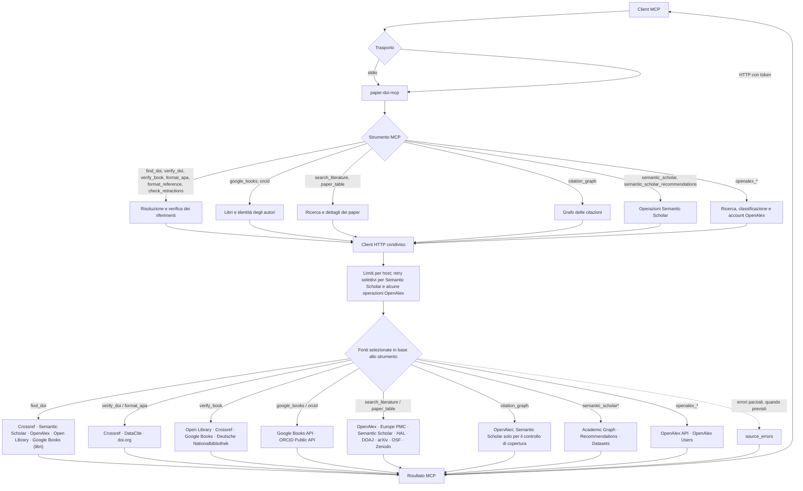

# paper-doi-mcp

Server MCP per verificare citazioni accademiche e cercare letteratura. Risolve e controlla DOI, verifica edizioni di libri, cerca su più database aperti e costruisce grafi di citazione da visualizzare. Il principio guida è la precisione: quando una corrispondenza non è sicura, lo strumento lo dice invece di proporre un DOI plausibile.

## Architettura

Il client invia una richiesta MCP; il server la instrada allo strumento corrispondente. Gli strumenti bibliografici interrogano le fonti pertinenti, mentre quelli dedicati inoltrano le operazioni alle API di OpenAlex o Semantic Scholar. Le richieste HTTP condividono trasporto, limiti e gestione degli errori.



## Strumenti

| Tool | Cosa fa | Fonti |
|---|---|---|
| `find_doi` | Trova il DOI di un articolo o libro a partire da titolo, primo autore e anno. Restituisce `match` solo se titolo, autore e anno concordano; altrimenti `no_confident_match`. Per i libri (`is_book=true`) l'anno deve coincidere con l'edizione citata; i dati di edizione e ISBN di Open Library e Google Books sono restituiti come identificativi alternativi (`book_info`, `book_info_google_books`). | Crossref, Semantic Scholar, OpenAlex, Open Library, Google Books (libri) |
| `verify_doi` | Controlla che un DOI esista e appartenga al lavoro atteso (titolo, autore, anno, volume, numero, pagine). Instrada per agenzia di registrazione: Crossref, oppure DataCite (Zenodo, arXiv, OSF, dataset); per gli altri registri restituisce `registered_unsupported_agency` invece di «non trovato». Segnala ritrattazioni, correzioni ed expressions of concern (solo Crossref). Con `expected_orcid` confronta l'ORCID iD con quelli depositati per gli autori (`author_orcids`): `match`; `mismatch` solo se tutti gli autori hanno un iD e nessuno è quello atteso; altrimenti `not_in_source`, perché il deposito è facoltativo. Per le agenzie non supportate l'iD compare in `unchecked`. | Crossref (con dati Retraction Watch), DataCite, doi.org |
| `verify_book` | Verifica un'edizione (anno, editore, ISBN) confrontando quattro cataloghi. `verified` se almeno due concordano. Il campo `agreement` conta i gruppi di cataloghi indipendenti (Open Library e Google Books condividono i feed degli editori e valgono come uno) e riporta il livello (`high` con almeno due gruppi e nessun conflitto, `medium` con un conflitto, `low` con un solo gruppo, `none`). In `conflicts` segnala anno o editore su cui due fonti confermanti non hanno nulla in comune (edizioni diverse, oppure marchio e gruppo editoriale), senza escludere il risultato. | Open Library, Crossref, Google Books, Deutsche Nationalbibliothek |
| `google_books` | Ricerca (`search`, con le parole chiave native `intitle:`, `inauthor:`, `isbn:`...) e lettura di un volume (`volume`): titolo, autori, editore, data, ISBN. Parametri nativi inoltrati in `params`; restituisce il JSON originale. | Google Books API |
| `internet_archive` | Libri e testi digitalizzati su Internet Archive (anche scansioni Open Library): per titolo, autore, anno, ISBN o query Lucene. Per ogni record l'accesso: `public` (lettura e PDF liberi), `borrowable` (prestito con account archive.org), `print_disabled_only`. | Internet Archive |
| `orcid` | Ricerca nel registro (`search`, sintassi Solr, con ORCID iD, nomi e istituzioni) e lettura dei dati pubblici di un record (`person`, `works`). L'iD viene validato col checksum prima della richiesta. Funziona senza credenziali; con `ORCID_CLIENT_ID` e `ORCID_CLIENT_SECRET` usa un token `/read-public`. Una corrispondenza di nome è un candidato, non un'identità. | ORCID Public API |
| `format_apa` | Restituisce il riferimento APA di un DOI tramite content negotiation, con i campi strutturati del record. Segnala con `title_case_suspected` i titoli che sembrano in title case (APA vuole il sentence case) senza convertirli. `unsupported` se l'agenzia di registrazione non lo offre. | doi.org |
| `format_reference` | Riferimento di un DOI in BibTeX, RIS, CSL-JSON o in qualsiasi stile CSL (`chicago-author-date`, `modern-language-association`, `ieee`…), tramite content negotiation. Stessa avvertenza di `format_apa`: i metadati non sono verificati. | doi.org |
| `check_retractions` | Ritrattazioni, expression of concern e correzioni per una lista di DOI (fino a 1000, es. tutta la libreria Zotero), da Crossref con i dati Retraction Watch. I DOI DataCite finiscono in `not_checked`. Al massimo 2 richieste parallele verso Crossref, con nuovi tentativi sui 429. | Crossref |
| `search_literature` | Ricerca con sintassi booleana su uno o più database, con abstract e keyword, deduplicazione e log riproducibile delle query. | OpenAlex, Europe PMC, Semantic Scholar, HAL, DOAJ, arXiv, OSF Preprints, Zenodo |
| `citation_graph` | Grafo di citazione attorno a uno o più lavori: riferimenti, lavori citanti più citati, archi di citazione, coppie co-citate e accoppiamento bibliografico (riferimenti in comune). Per ogni nodo indica a quanti seed è collegato. Pensato per visualizzazioni D3 (timeline anno/citazioni, rete di somiglianza). Con `check_coverage` (predefinito) confronta per ogni seed con DOI i conteggi di riferimenti e citazioni tra OpenAlex e Semantic Scholar (`coverage_check`), per distinguere un'assenza reale da una lacuna di copertura. | OpenAlex, Semantic Scholar (solo controllo) |
| `map_create`, `map_add_seeds` | Crea una mappa della letteratura persistente (SQLite sul Pi) e aggiunge i seed (DOI o id OpenAlex); un candidato già nella mappa diventa seed. | OpenAlex |
| `map_expand` | Fa crescere la mappa dai seed: `references`, `citing`, `similar` (raccomandazioni Semantic Scholar), `authors` (lavori più citati dei primi tre autori). I nuovi lavori entrano come candidati con stato `new`; massimo 2000 lavori per mappa. | OpenAlex, Semantic Scholar |
| `map_suggest` | Candidati più probabilmente mancanti, ordinati per `seeds_linked`, `seed_cocited`, `seed_coupling`, citazioni; esclude letti e scartati. Dice perché (`found_by`). | Calcolo locale |
| `map_mark` | Stato di lettura: `to_read`, `read`, `dismissed`, `new`, con una nota facoltativa. Lo stato vive nella mappa, non nelle note. | Calcolo locale |
| `map_get`, `map_list` | Contenuto di una mappa (lavori e collegamenti ricalcolati: citazioni, co-citazione, coupling) e elenco delle mappe con i conteggi. | Calcolo locale |
| `map_rename`, `map_remove`, `map_delete` | Rinomina una mappa o ne cambia la descrizione; toglie singoli lavori; elimina una mappa intera (serve ripetere il nome esatto in `confirm_name`). | Calcolo locale |
| `map_watch` | Nuovi lavori che citano i seed dall'ultimo controllo (o dalla creazione), aggiunti come candidati. Controllo su richiesta, non un avviso in background. | OpenAlex |
| `map_check_retractions` | Ritrattazioni, expression of concern e correzioni per tutti i lavori con DOI della mappa; i ritrattati vengono segnati. | Crossref |
| `map_export` | La mappa come lista di lettura in Markdown (seed, poi lavori per stato, con link DOI, Zotero e note), da salvare in Obsidian fuori dallo schema, es. `Maps/<nome>.md`. | Calcolo locale |
| `paper_table` | Righe di dettaglio per una lista di DOI, id OpenAlex o id arXiv (fino a 300): abstract, keyword, topic, TL;DR, sede, accesso aperto, ritrattazione. | OpenAlex (a blocchi di 50), arXiv come riserva, Semantic Scholar (una richiesta batch) |
| `semantic_scholar` | Academic Graph e Datasets in uno strumento con 18 azioni: paper (dettagli, autori, citazioni, riferimenti, batch, ricerca per rilevanza, bulk booleana, match, autocompletamento), autori (dettagli, pubblicazioni, ricerca, batch), estratti testuali, release e link dei dataset. Non scarica i file. | Semantic Scholar Academic Graph e Datasets |
| `semantic_scholar_recommendations` | Raccomandazioni da un paper o da liste di esempi positivi e negativi. | Semantic Scholar Recommendations |
| `openalex_entity` | Liste e dettagli di tutte le 26 risorse del catalogo, con filtri, ricerca, aggregazioni, campi e cursori liberi. | OpenAlex |
| `openalex_autocomplete` | Suggerimenti e risoluzione rapida di identificatori, globali o per tipo di entità. | OpenAlex |
| `openalex_text` | Classifica titolo e abstract per topic e keyword, tramite GET o POST. | OpenAlex |
| `openalex_query` | Esegue e traduce OQL/OQO; valida query, consulta contesto grammaticale, proprietà e specifiche. | OpenAlex |
| `openalex_status` | Consulta quota e metadati/link dei changefiles; questi ultimi richiedono un piano abilitato. | OpenAlex |
| `openalex_account_read` | Legge collezioni, membri, importazioni e ricerche salvate, senza modificarli. | OpenAlex |
| `openalex_account_write` | Crea, aggiorna o elimina collezioni e ricerche salvate, gestisce membri/importazioni e invia correzioni. Anteprima predefinita; richiede conferma esplicita per inviare. | OpenAlex, OpenAlex Users |

### Copertura OpenAlex

I sette strumenti dedicati coprono le risorse e le operazioni utente correnti del [catalogo degli endpoint](https://help.openalex.org/api/endpoints/), integrate con le pagine di [query OQL/OQO](https://help.openalex.org/api/oql/), [collezioni](https://help.openalex.org/api/collections/), [ricerche salvate](https://help.openalex.org/api/alerts/) e [correzioni](https://help.openalex.org/api/author-curation/), consultate il 21 ottobre 2026. I vecchi strumenti bibliografici restano invariati. Non sono esposte le route amministrative, le vecchie route account deprecate né le operazioni di creazione/rotazione delle credenziali.

`openalex_entity` espone `GET /{entity}` e `GET /{entity}/{entity_id}` per queste risorse:

| Gruppo | Valori di `entity` |
|---|---|
| Entità principali | `works`, `authors`, `sources`, `institutions`, `publishers`, `funders`, `awards` |
| Componenti | `locations`, `raw-affiliation-strings` (solo lista, senza identificatore singolo) |
| Classificazioni | `topics`, `subfields`, `fields`, `domains`, `keywords`, `sdgs`, `study-designs`, `concepts` (deprecato) |
| Vocabolari | `work-types`, `source-types`, `institution-types`, `countries`, `continents`, `languages`, `licenses`, `indexes`, `source-lists` |

Omettere `entity_id` per una lista. Per i dettagli sono ammessi gli ID OpenAlex e gli identificatori esterni supportati dalla fonte, per esempio DOI/PMID per i lavori, ORCID per gli autori, ROR per le istituzioni e ISSN per le sedi. Gli identificatori delle locations conservano maiuscole e minuscole.

`params` inoltra i parametri nativi, compresi `filter`, `search`, `search.semantic`, `sort`, `group_by`, `select`, `page`, `per_page`, `cursor`, `sample`, `seed` e `corpus`; OpenAlex ne verifica la validità per la risorsa scelta. Ogni chiamata recupera una pagina: per la paginazione profonda iniziare con `cursor="*"`, poi usare `data.meta.next_cursor`. La chiave si configura esclusivamente con `OPENALEX_API_KEY`, non in `params`.

Esempio di argomenti per `openalex_entity`, lavori dal 2020 raggruppati per anno:

```json
{
  "entity": "works",
  "params": {
    "filter": "publication_year:2020-,title_and_abstract.search:design ethics",
    "group_by": "publication_year"
  }
}
```

| Strumento / azione | Metodi e percorsi |
|---|---|
| `openalex_autocomplete` | `GET /autocomplete`, `GET /autocomplete/{entity}`; `query` diventa il parametro `q` |
| `openalex_text` | `GET` e `POST` su `/text`, `/text/topics`, `/text/keywords`; `target`: `all`, `topics`, `keywords` |
| `openalex_query`, `execute` | `GET /?oql=...`, `GET /?oqo=...`, `POST /` con uno dei due formati |
| `openalex_query`, `translate` | `GET /query/{query_format}/{query}`, `POST /query`; formati `oql`, `oqo`, `oxurl` |
| `openalex_query`, `validate` / `context` | `GET /validate`, `GET /parse-context`; per il contesto serve `params.pos` |
| `openalex_query`, `properties` / `spec` | `GET /properties[/{entity}]`, `GET /query/spec[/{artifact}]` |
| `openalex_status` | `GET /rate-limit`, `GET /changefiles`, `GET /changefiles/{date}` |
| `openalex_account_read` | `GET /collections[/{collection_id}]`, membri, elenco/dettaglio importazioni; `GET /saved-searches[/{saved_search_id}]` |
| `openalex_account_write` | `POST /collections`, `PATCH`/`DELETE /collections/{collection_id}`, `POST`/`DELETE` dei membri, `DELETE` del singolo membro, `POST` delle importazioni; `POST`/`PATCH`/`DELETE` delle ricerche salvate; `POST user.openalex.org/curations` |

**Query e testo.** `openalex_query` accetta `query` come stringa OQL o oggetto OQO, `query_format` e `method` (`POST` predefinito per evitare limiti di lunghezza dell'URL). Ordinamento, campi e paginazione restano in `params`. `translate` non esegue la ricerca; `validate` restituisce le diagnostiche originali. `openalex_text` richiede da 20 a 2000 caratteri complessivi tra titolo e abstract; costa $0.01 per richiesta secondo la documentazione consultata. Non inviare materiale riservato senza autorizzazione. La ricerca semantica è disponibile tramite `openalex_entity` con `params["search.semantic"]` oppure tramite OQL/OQO.

**Account e conferma.** Le azioni di lettura sono `collections`, `collection`, `members`, `imports`, `import`, `saved_searches`, `saved_search`. Le azioni di scrittura sono `create_collection`, `update_collection`, `delete_collection`, `add_members`, `remove_members`, `remove_member`, `import_collection`, `create_saved_search`, `update_saved_search`, `delete_saved_search`, `curate`. Gli identificatori si passano negli argomenti dedicati; il JSON nativo va in `body`. Per la rimozione multipla dei membri si usa invece `params.member_ids`, una stringa separata da virgole, senza body.

Con `confirm=false` (predefinito), una scrittura restituisce solo l'anteprima `confirmation_required` e non invia alcuna richiesta. Per inviare una scrittura servono sia `confirm=true` sia `OPENALEX_ENABLE_WRITES=true` nell'ambiente del server; l'abilitazione è disattivata per default. Dopo aver mostrato l'operazione e ottenuto l'approvazione dell'utente, ripetere la stessa chiamata con `confirm=true`. Esempio di anteprima per creare una collezione:

```json
{
  "action": "create_collection",
  "body": {
    "display_name": "Design ethics",
    "entity_type": "works",
    "access": "private"
  }
}
```

Le collezioni e le ricerche salvate richiedono una chiave personale e i permessi appropriati. Gli alert possono inviare email all'account; una cancellazione elimina anche membri o alert associati. Le importazioni eseguono ricerche lato OpenAlex e consumano quota. Le correzioni richiedono i permessi sul profilo e possono modificare record pubblici. Nessuna di queste operazioni viene eseguita durante i test offline.

**Risposte e limiti.** Le risposte mantengono `status`, `http_status` e `data`, inclusi metadati, costi, gruppi, cursori e codici di errore; le credenziali vengono redatte, anche se restituite dall'endpoint della quota. Una cancellazione riuscita con HTTP 204 restituisce `data=null`. CSV e specifiche testuali sono supportati (con `next_cursor` dall'header per i CSV); archivi binari non vengono decodificati. I changefiles restituiscono link senza scaricarne i file. Non c'è paginazione o polling automatico.

Il trasporto applica un limite conservativo di 1 richiesta/s per ciascun host OpenAlex, anche alle funzioni esistenti: copre i limiti più stretti di testo e ricerca semantica. Le letture e i POST di interrogazione/classificazione ritentano sui 429 fino a quattro tentativi complessivi, con attese fino a 10 s; le scritture dell'account non vengono ritentate automaticamente. Il coordinamento vale nella singola istanza, non tra applicazioni che condividono la chiave.

### Copertura Semantic Scholar

Due strumenti dedicati coprono le 20 operazioni delle specifiche ufficiali [Academic Graph](https://api.semanticscholar.org/api-docs/graph), [Recommendations](https://api.semanticscholar.org/api-docs/recommendations) e [Datasets](https://api.semanticscholar.org/api-docs/datasets), consultate il 21 ottobre 2026: `semantic_scholar` (18 azioni, un'unica voce per ridurre la sovrapposizione di strumenti simili) e `semantic_scholar_recommendations` (2 azioni). Non modificano il comportamento degli strumenti precedenti: `citation_graph` continua a usare OpenAlex. I nomi `semantic_scholar_paper`, `_author`, `_snippets` e `_datasets` delle versioni precedenti non esistono più: dopo l'aggiornamento il client deve rileggere l'elenco degli strumenti.

| Strumento | `action` | Metodo e percorso |
|---|---|---|
| `semantic_scholar` | `paper_details` | `GET /graph/v1/paper/{paper_id}` |
| `semantic_scholar` | `paper_authors` | `GET /graph/v1/paper/{paper_id}/authors` |
| `semantic_scholar` | `paper_citations` | `GET /graph/v1/paper/{paper_id}/citations` |
| `semantic_scholar` | `paper_references` | `GET /graph/v1/paper/{paper_id}/references` |
| `semantic_scholar` | `paper_batch` | `POST /graph/v1/paper/batch` |
| `semantic_scholar` | `paper_search` | `GET /graph/v1/paper/search` |
| `semantic_scholar` | `paper_bulk` | `GET /graph/v1/paper/search/bulk` |
| `semantic_scholar` | `paper_match` | `GET /graph/v1/paper/search/match` |
| `semantic_scholar` | `paper_autocomplete` | `GET /graph/v1/paper/autocomplete` |
| `semantic_scholar` | `author_details` | `GET /graph/v1/author/{author_id}` |
| `semantic_scholar` | `author_papers` | `GET /graph/v1/author/{author_id}/papers` |
| `semantic_scholar` | `author_search` | `GET /graph/v1/author/search` |
| `semantic_scholar` | `author_batch` | `POST /graph/v1/author/batch` |
| `semantic_scholar` | `snippets` | `GET /graph/v1/snippet/search` |
| `semantic_scholar_recommendations` | `single` | `GET /recommendations/v1/papers/forpaper/{paper_id}` |
| `semantic_scholar_recommendations` | `multi` | `POST /recommendations/v1/papers/` |
| `semantic_scholar` | `dataset_releases` | `GET /datasets/v1/release/` |
| `semantic_scholar` | `dataset_release` | `GET /datasets/v1/release/{release_id}` |
| `semantic_scholar` | `dataset_files` | `GET /datasets/v1/release/{release_id}/dataset/{dataset_name}` |
| `semantic_scholar` | `dataset_diffs` | `GET /datasets/v1/diffs/{start_release_id}/to/{release_id}/{dataset_name}` |

**Parametri e risposte.** Gli strumenti restituiscono `status`, `http_status` e `data`, che conserva il JSON originale, inclusi campi annidati, valori null, licenze e cursori. Gli errori HTTP conservano la risposta dell'API; gli errori di trasporto restituiscono `status=error` e `detail`. Gli input obbligatori mancanti, i batch fuori limite e gli argomenti che un'azione non usa vengono rifiutati prima della richiesta. L'API verifica la validità dei parametri di query e dei campi richiesti.

`params` accetta i nomi nativi dell'API, senza traduzioni: `fields`, `query`, `year`, `publicationDateOrYear`, `publicationTypes`, `venue`, `fieldsOfStudy`, `minCitationCount` e gli altri parametri disponibili per l'endpoint. `openAccessPdf` si passa come stringa vuota. Per gli estratti, la query è invece l'argomento `query` dello strumento. Gli identificatori dei paper possono usare i formati accettati dall'API, per esempio `DOI:10.1000/example`, `ARXIV:2401.01234` o `CorpusId:123`; gli autori richiedono l'id Semantic Scholar. Il batch ammette al massimo 500 paper o 1000 autori, senza troncamenti automatici.

**Paginazione.** Ogni chiamata recupera una sola pagina. Passare `data.next` come `params.offset` per le liste paginate; per `paper_bulk`, passare `data.token` come `params.token`. La ricerca per rilevanza ammette `limit` fino a 100 e fino a 1000 risultati complessivi; `paper_bulk` restituisce fino a 1000 risultati per pagina e non accetta `limit` o `offset`. Le liste di citazioni, riferimenti, autori di un paper e pubblicazioni di un autore ammettono `limit` fino a 1000. Raccomandazioni ed estratti non prevedono cursori di pagina.

Esempio di argomenti per `semantic_scholar`, ricerca booleana con ordinamento per citazioni:

```json
{
  "action": "paper_bulk",
  "params": {
    "query": "(\"human computer interaction\" | design) + ethics",
    "year": "2020-",
    "sort": "citationCount:desc",
    "fields": "title,year,authors,externalIds,citationCount"
  }
}
```

Per le raccomandazioni, `single` richiede `paper_id` e ammette `params.from` (`recent` o `all-cs`); `multi` richiede `positive_paper_ids` e accetta `negative_paper_ids`. Entrambe ammettono `params.fields` e `params.limit` fino a 500. Per i dataset, `release_id` è `latest` di default; `dataset_files` richiede `dataset_name`, mentre `dataset_diffs` richiede anche `start_release_id`. I nomi dei dataset si ricavano con `dataset_release`. I link firmati sono temporanei e vanno trattati come credenziali di accesso; disponibilità e permessi dipendono dalla chiave API. Nessun file del corpus viene scaricato o applicato localmente.

I risultati di `match` e delle raccomandazioni non equivalgono a citazioni bibliografiche verificate: per questo restano disponibili `find_doi` e `verify_doi`.

## Prompt (scorciatoie)

Nei client che supportano i prompt MCP (in Claude web: menu del connettore, "Add from …") sono disponibili scorciatoie che compilano la richiesta e richiamano gli strumenti nell'ordine giusto. I campi sono in testo libero: si scrive il riferimento come lo si ricorda, e Claude ricava titolo, autore e anno e risolve i titoli in DOI. I campi facoltativi lasciati vuoti fanno usare a Claude quello che è già nella conversazione (la mappa o la ricerca precedente).

| Prompt | Campi | Cosa fa |
|---|---|---|
| Verifica riferimenti | un riferimento come lo ricordi, un DOI o una bibliografia incollata; vuoto per tutti quelli citati in chat | Per ogni voce sceglie: `find_doi` se manca il DOI, `verify_doi` se c'è, `find_doi` con `is_book=true` e `verify_book` per i libri; tabella degli esiti e lista APA aggiornata |
| Ricerca letteratura | tema con parole tue; facoltativo: anni | Claude costruisce la query e sceglie i database; `search_literature` con tabella e log |
| Mappa delle citazioni | DOI o titoli, o vuoto per i lavori di cui si sta parlando | `citation_graph` e artifact D3; poi le possibili letture mancanti |
| Tabella dei paper | DOI o titoli, o vuoto per la mappa o ricerca precedente | `paper_table` con tabella compatta; abstract completi su richiesta |

## Come recupera e confronta i dati

**Richieste.** Tutte le chiamate passano da un unico client HTTP condiviso. Un trasporto dedicato limita le richieste contemporanee per host (5 di default, 1 per Semantic Scholar, OpenAlex e arXiv, 2 per Crossref e archive.org) e impone un intervallo minimo di 1 s per Semantic Scholar e ciascun host OpenAlex, 3 s per arXiv. I retry sui 429 sono previsti per Semantic Scholar e per le letture e i POST di interrogazione/classificazione OpenAlex: fino a quattro tentativi complessivi, con attese di al massimo 10 s. Le scritture dell'account OpenAlex e le altre fonti non vengono ritentate automaticamente. Nelle ricerche multi-fonte, le fonti vengono interrogate in parallelo: se una fallisce, l'errore finisce in `source_errors` e le altre proseguono. I record Crossref restano in cache per un'ora.

**Semantic Scholar.** Il limite di 1 richiesta al secondo resta attivo anche con la chiave API ed è cumulativo su tutti gli endpoint di Academic Graph, Recommendations e Datasets, inclusi i retry. Il coordinamento vale per una singola istanza del server; altre istanze o applicazioni che usano la stessa chiave consumano la medesima quota e richiedono un coordinamento esterno.

**OpenAlex.** Se configurata, `OPENALEX_API_KEY` viene aggiunta come parametro `api_key` alle richieste su `api.openalex.org`, incluse ricerca DOI, ricerca bibliografica, grafi, tabelle e strumenti dedicati. Le correzioni su `user.openalex.org` usano invece l'header `Authorization: Bearer`. `CONTACT_EMAIL` resta compatibile e viene inviato come `mailto` sul primo host. La chiave non viene inclusa nei log riproducibili restituiti dagli strumenti e viene rimossa dagli URL delle risposte prima di generare errori HTTP. Configurarla nell'ambiente del processo, senza inserirla nel codice o nel repository, e riavviare il server. Eventuali log HTTP di debug esterni vanno protetti, dato che sul primo host l'autenticazione viaggia nell'URL.

**Confronto dei titoli.** I titoli vengono normalizzati (accenti rimossi, script non latini conservati, HTML e prefissi come "RETRACTED:" eliminati) e confrontati con `SequenceMatcher`, considerando anche le varianti con e senza sottotitolo. La soglia è 0.88.

**Regole di accettazione in `find_doi`.**
- Un autore che non corrisponde, o un anno distante più di uno, esclude il candidato.
- Titoli sotto le quattro parole richiedono la conferma dell'autore.
- Errata, avvisi di ritrattazione, peer review e repliche vengono scartati (`excluded_derivatives`).
- Le fonti secondarie ricavano i DOI in buona parte da Crossref: la presenza di un DOI in più indici non è una conferma indipendente.
- `agreement` conta le fonti indipendenti (`independent_sources`): Crossref, OpenAlex e Semantic Scholar valgono come una sola, perché OpenAlex e Semantic Scholar derivano in gran parte da Crossref. `competing_dois` elenca gli altri DOI compatibili col titolo (spesso preprint o altra versione), da confermare. Anche in `search_literature` ogni record ha `independent_sources`, con la stessa regola.

**Grafo di citazione.** `citation_graph` parte dai lavori seed, scarica i loro riferimenti e i lavori citanti più citati, ordina i candidati per numero di seed collegati e poi per citazioni, e tiene i primi `max_nodes`. Le co-citazioni sono calcolate solo sui lavori presenti nel grafo, quindi sono un limite inferiore. L'accoppiamento usa le liste di riferimenti complete e riporta sia il numero di riferimenti condivisi sia una forza normalizzata (0–1); collega anche i lavori recenti, che non hanno ancora co-citazioni. Un accoppiamento molto alto tra due nodi può indicare due record dello stesso lavoro.

## Limiti noti

- La filosofia è coperta male da tutte le fonti; PhilPapers non ha un'API accessibile.
- OpenAlex ha liste di riferimenti incomplete per molti lavori umanistici e datati.
- In `search_literature` i filtri `doc_types`, `open_access_only` ed `exclude_retracted` valgono solo per OpenAlex; gli altri database li riportano in `ignored_filters`. La deduplicazione vale per la singola pagina.
- Senza chiave API Semantic Scholar risponde spesso 429.
- Le edizioni ("2nd ed.") e il numero di pagine dei libri non sono verificabili con queste fonti.
- Google Books e Open Library possono derivare i dati dagli stessi feed degli editori: l'accordo tra i cataloghi è una corroborazione, non una prova. Senza chiave la quota di Google Books è condivisa e può dare 429.
- ORCID: solo i dati resi pubblici dal ricercatore; i nomi non identificano da soli una persona.
- `verify_doi` non ha una fonte di ritrattazioni per i DOI DataCite: `is_retracted` è `null` (sconosciuto), mai `false`. I DOI di altre agenzie (mEDRA, JaLC...) risultano registrati ma non verificabili nei metadati.
- Il controllo di copertura di `citation_graph` confronta solo i conteggi dei seed, non le liste: OpenAlex e Semantic Scholar derivano in parte da Crossref, quindi la concordanza non è una prova indipendente.
- DBLP risponde con una sfida proof-of-work (Anubis) e non è integrato.
- `format_apa` riproduce i metadati come li ha depositati l'editore e non li verifica: con un `mismatch` di `verify_doi` il riferimento va composto dai valori verificati. `title_case_suspected` è un'euristica sul numero di parole capitalizzate (i nomi propri la falsano e sotto tre parole utili non giudica); nessuna conversione automatica del titolo.

## Installazione

Richiede Python 3.10+ e [uv](https://docs.astral.sh/uv/).

```sh
uv sync
uv run python -m pytest -q
```

La suite gira senza rete. I test in `tests/test_server.py` coprono normalizzazione dei titoli, confronto degli autori, scarto di errata e repliche, pulizia dei DOI, calcolo di co-citazioni e accoppiamento. Verificano anche routing e payload delle API, autenticazione, redazione delle credenziali, cursori e formati di risposta, errori HTTP, retry, limite cumulativo Semantic Scholar, registrazione e annotazioni MCP, anteprime senza richieste e scritture OpenAlex confermate su risposte simulate. Coprono inoltre Google Books, ORCID (validazione degli iD, token `/read-public` con cache e rinnovo dopo un 401) e il calcolo di `agreement` e dei conflitti tra cataloghi. Questi test non verificano online la validità delle chiavi, i permessi dell'account o la disponibilità reale degli endpoint.

### Struttura

| File | Contenuto |
|---|---|
| `server.py` | Tutto il server: strumenti, prompt, client HTTP, modalità stdio e HTTP |
| `tests/test_server.py` | Test offline |
| `pyproject.toml`, `uv.lock` | Dipendenze e versioni bloccate |

### Uso locale (stdio), ad esempio in VS Code

```json
{
  "servers": {
    "paper-doi": {
      "type": "stdio",
      "command": "uv",
      "args": ["--directory", "/percorso/a/doi-mcp", "run", "server.py"],
      "env": {
        "CONTACT_EMAIL": "tu@example.org",
        "OPENALEX_API_KEY": "${input:openalex-api-key}",
        "SEMANTIC_SCHOLAR_API_KEY": "${input:semantic-scholar-api-key}",
        "GOOGLE_BOOKS_API_KEY": "${input:google-books-api-key}",
        "ORCID_CLIENT_ID": "${input:orcid-client-id}",
        "ORCID_CLIENT_SECRET": "${input:orcid-client-secret}"
      }
    }
  },
  "inputs": [
    {
      "type": "promptString",
      "id": "openalex-api-key",
      "description": "OpenAlex API key",
      "password": true
    },
    {
      "type": "promptString",
      "id": "semantic-scholar-api-key",
      "description": "Semantic Scholar API key",
      "password": true
    },
    {
      "type": "promptString",
      "id": "google-books-api-key",
      "description": "Google Books API key",
      "password": true
    },
    {
      "type": "promptString",
      "id": "orcid-client-id",
      "description": "ORCID client ID"
    },
    {
      "type": "promptString",
      "id": "orcid-client-secret",
      "description": "ORCID client secret",
      "password": true
    }
  ]
}
```

In VS Code, aprire la configurazione con **MCP: Open User Configuration** e unire la voce del server e gli input a quelli già presenti. Al primo avvio VS Code chiede le chiavi in campi protetti, senza salvarle nel JSON. Dopo modifiche al codice o alle variabili, riavviare `paper-doi` da **MCP: List Servers**. Per usare le fonti senza chiave, omettere la variabile corrispondente e il relativo input.

### Uso remoto (HTTP), ad esempio per Claude web

Con `MCP_TRANSPORT=http` il server espone Streamable HTTP su `127.0.0.1` e richiede un token, passato come header `Authorization: Bearer` oppure come parametro `?token=` (Claude web non permette header personalizzati). Va pubblicato dietro un proxy HTTPS, ad esempio Tailscale Funnel o Cloudflare Tunnel. Il log degli accessi è disattivato perché il token viaggia nell'URL.

Le chiavi `OPENALEX_API_KEY` e `SEMANTIC_SCHOLAR_API_KEY` vanno impostate nell'ambiente del servizio remoto, non nella configurazione del client HTTP. Gli input protetti di VS Code dell'esempio stdio non configurano un server remoto. Riavviare il servizio dopo averle aggiunte o cambiate.

Su un server senza uv si può installare con pip dalle versioni bloccate:

```sh
uv export --no-dev --no-emit-project --format requirements-txt > requirements.lock.txt
python3 -m venv .venv && .venv/bin/pip install --require-hashes -r requirements.lock.txt
```

Per aggiornare: copiare `server.py` (e, se cambiano le dipendenze, rifare l'installazione), poi riavviare il servizio. Dopo modifiche a strumenti o prompt, in Claude web il connettore va disattivato e riattivato perché rilegga l'elenco.

## Variabili d'ambiente

| Variabile | Uso |
|---|---|
| `CONTACT_EMAIL` | Email per il polite pool di Crossref e OpenAlex (consigliata) |
| `STATE_DIRECTORY` | Cartella delle mappe (`maps.sqlite`); impostata da systemd con `StateDirectory=doi-mcp`, cioè `/var/lib/doi-mcp` |
| `IA_ACCESS_KEY`, `IA_SECRET_KEY` | Chiavi S3 di archive.org (facoltative): la ricerca funziona anche senza; se presenti vengono inviate come `Authorization: LOW` |
| `OPENALEX_API_KEY` | Chiave OpenAlex: parametro `api_key` su `api.openalex.org`, header Bearer su `user.openalex.org` per le correzioni |
| `OPENALEX_ENABLE_WRITES` | Abilita le scritture confermate dell'account OpenAlex solo se impostata a `true`; default disattivato |
| `SEMANTIC_SCHOLAR_API_KEY` | Chiave inviata nell'header `x-api-key`; resta il limite cumulativo di 1 richiesta/s su tutti gli endpoint |
| `GOOGLE_BOOKS_API_KEY` | Facoltativa: chiave inviata nell'header `x-goog-api-key` (mai nell'URL) per aumentare la quota di Google Books |
| `ORCID_CLIENT_ID`, `ORCID_CLIENT_SECRET` | Facoltative, da impostare insieme: il server ottiene un token `/read-public` da `orcid.org/oauth/token`, lo tiene in memoria e lo invia come Bearer all'API pubblica. Il secret non viene inviato ad altri host né incluso negli errori |
| `MCP_TRANSPORT` | `stdio` (default) o `http` |
| `PORT` | Porta HTTP, default 3002 |
| `MCP_AUTH_TOKEN` | Obbligatorio in modalità HTTP, almeno 32 caratteri (`openssl rand -hex 32`) |
| `MCP_ALLOWED_HOSTS` | Host pubblici accettati dietro il proxy, separati da virgola |

## Mappe: ponte con Zotero e Obsidian

Il DOI MCP non chiama Zotero e non legge il vault. Legge due istantanee in `/var/lib/knowledge` (gruppo `knowledge`, sola lettura per questo servizio), aggiornate ogni ora da altri servizi: `library.json` dall'MCP Zotero (`snapshot.py`), `notes.json` dall'MCP Obsidian (`dist/snapshot.js`). Da lì `map_get`, `map_suggest` e `map_export` aggiungono a ogni lavoro `in_library`, `zotero_key` e le note che lo citano nel `reference`; `map_add_seeds` accetta `zotero_collection` o `zotero_tag`. Senza istantanee queste funzioni lo dicono e il resto funziona.

Quando OpenAlex non ha la bibliografia di un seed (libri, scienze umane), `map_add_seeds` la prende da Semantic Scholar se c'è; `map_suggest` usa anche `cocited_total` (co-citazione con qualsiasi lavoro della mappa) per separare i candidati quando un solo seed li collega tutti, e avvisa se nessun seed ha bibliografia.

La pagina *Literature maps* (https://claude.ai/artifact/34ALXDYU74t27u6qmYnfUT) legge le mappe dal vivo tramite il connettore DOI.

Drop-in systemd usato sul Pi (`/etc/systemd/system/doi-mcp.service.d/state.conf`):

```
[Service]
StateDirectory=doi-mcp
StateDirectoryMode=0750
SupplementaryGroups=knowledge
Environment=KNOWLEDGE_DIR=/var/lib/knowledge
```
